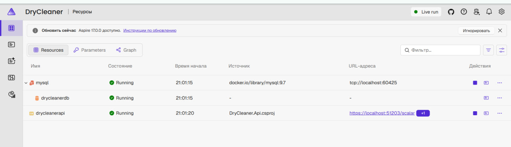
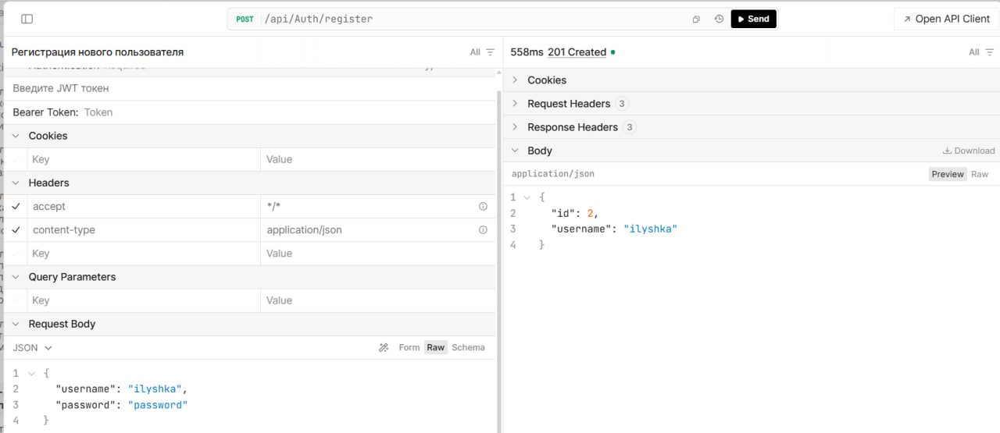
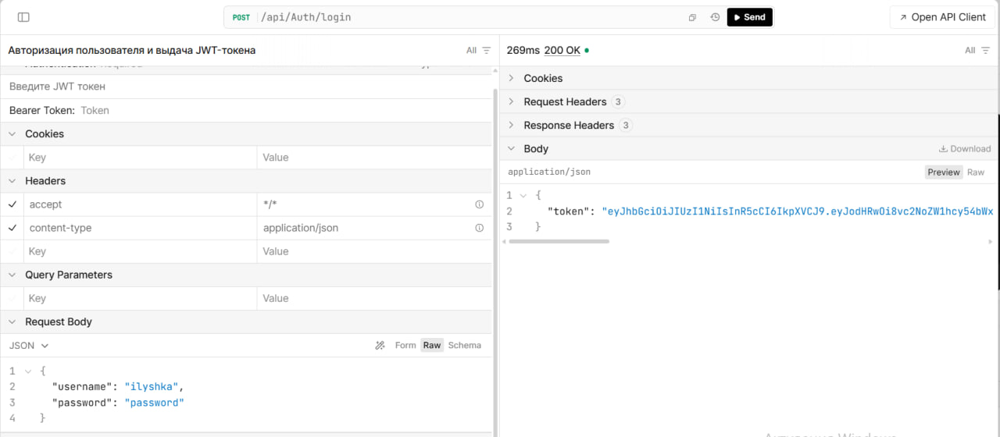
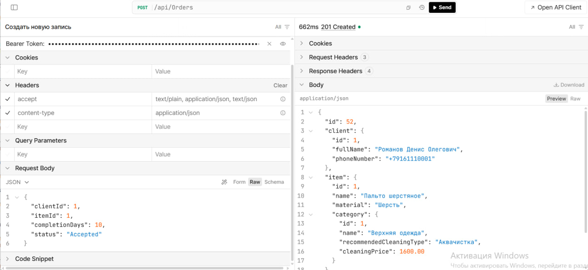
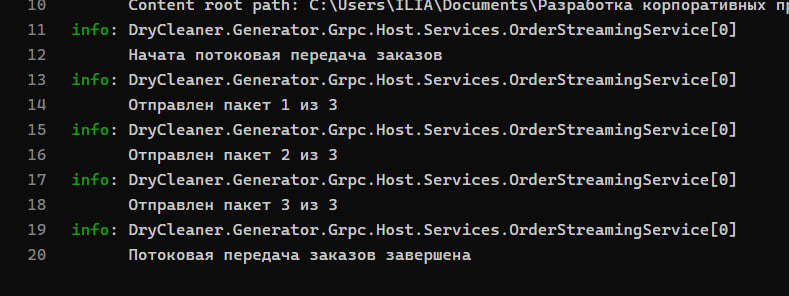
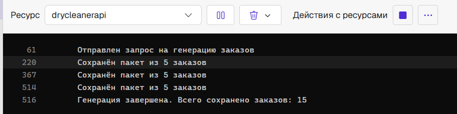
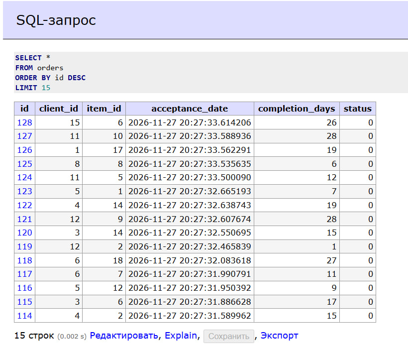
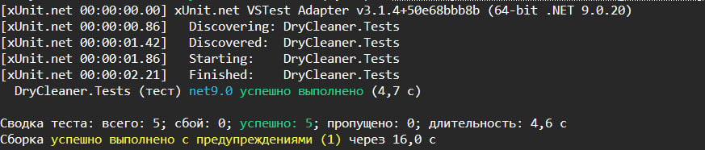

# Разработка корпоративных приложений
[Таблица с успеваемостью](https://docs.google.com/spreadsheets/d/1nHewCKHKgS9BqbfIv1GTuropMRdFEIDgqLwYDaufA-U/edit?pli=1&gid=0#gid=0)

## Задание
### Цель
Реализация проекта сервисно-ориентированного приложения.

### Задачи
* Реализация объектно-ориентированной модели данных,
* Изучение реализации серверных приложений на базе WebAPI/OpenAPI,
* Изучение работы с брокерами сообщений,
* Изучение паттернов проектирования,
* Изучение работы со средствами оркестрации на примере .NET Aspire,
* Повторение основ работы с системами контроля версий,
* Unit-тестирование.

### Лабораторные работы
<details>
<summary>1.	«Классы» - Реализация объектной модели данных и unit-тестов</summary>
<br> 
В рамках первой лабораторной работы необходимо подготовить структуру классов, описывающих предметную область, определяемую в задании. В каждом из заданий присутствует часть, связанная с обработкой данных, представленная в разделе «Unit-тесты». Данную часть необходимо реализовать в виде unit-тестов: подготовить тестовые данные, выполнить запрос с использованием LINQ, проверить результаты.  

Хранение данных на этом этапе допускается осуществлять в памяти в виде коллекций.  
Необходимо включить **как минимум 10** экземпляров каждого класса в датасид. 
  
</details>
<details>
<summary>2.	«Сервер» - Реализация серверного приложения с использованием REST API</summary>
<br> 
Во второй лабораторной работе необходимо реализовать серверное приложение, которое должно:
- Осуществлять базовые CRUD-операции с реализованными в первой лабораторной сущностями
- Предоставлять результаты аналитических запросов (раздел «Unit-тесты» задания)

Хранение данных на этом этапе допускается осуществлять в памяти в виде коллекций.
<br> 
</details>
<details>
<summary>3.	«ORM» - Реализация объектно-реляционной модели. Подключение к базе данных и настройка оркестрации</summary>
<br> 
В третьей лабораторной работе хранение должно быть переделано c инмемори коллекций на базу данных.  
Должны быть созданы миграции для создания таблиц в бд и их первоначального заполнения.
<br> 
Также необходимо настроить оркестратор Aspire на запуск сервера и базы данных.
<br> 
</details>
<details>
<summary>4.	«Инфраструктура» - Реализация сервиса генерации данных и его интеграция с сервером</summary>
<br>  
В четвертой лабораторной работе необходимо имплементировать сервис, который генерировал бы контракты. Контракты далее передаются в сервер и сохраняются в бд.
Сервис должен представлять из себя отдельное приложение без референсов к серверным проектам за исключением библиотеки с контрактами.
Отправка контрактов при помощи gRPC должна выполняться в потоковом виде.
При использовании брокеров сообщений, необходимо предусмотреть ретраи при подключении к брокеру.

Также необходимо добавить в конфигурацию Aspire запуск генератора и (если того требует вариант) брокера сообщений.
<br> 
</details>
<details>
<summary>5.	«Клиент» - Интеграция клиентского приложения с оркестратором</summary>
<br> 
В пятой лабораторной необходимо добавить в конфигурацию Aspire запуск клиентского приложения для написанного ранее сервера. Клиент создается в рамках курса "Веб разработка" либо реализуется в рамках лабораторных с использованием Blazor Web Assembly.
<br> 
</details>

## Задание. Общая часть
**Обязательно**:
* Реализация серверной части на [.NET 10](https://learn.microsoft.com/ru-ru/dotnet/core/whats-new/dotnet-10/overview).
* Реализация серверной части на [ASP.NET](https://dotnet.microsoft.com/ru-ru/apps/aspnet).
* Реализация unit-тестов с использованием [xUnit v3](https://xunit.net/?tabs=cs).
* Использование хранения данных в базе данных согласно варианту задания.
* Оркестрация проектов при помощи [.NET Aspire 13.5](https://learn.microsoft.com/ru-ru/dotnet/aspire/get-started/aspire-overview)
* Реализация сервиса генерации данных при помощи [Bogus](https://github.com/bchavez/Bogus) и его взаимодейсвие с сервером согласно варианту задания.
* Автоматизация тестирования на уровне репозитория через [GitHub Actions](https://docs.github.com/en/actions/learn-github-actions/understanding-github-actions).
* Создание минимальной документации к проекту: страница на GitHub с информацией о задании, скриншоты приложения и прочая информация.

**Факультативно**:
* Реализация авторизации/аутентификации.
* Реализация интеграционных тестов при помощи .NET Aspire.
* Реализация клиента на Blazor WASM.

Внимательно прочитайте [дискуссии](https://github.com/itsecd/enterprise-development/discussions/1) о том, как работает автоматическое распределение на ревью.
Сразу корректно называйте свои pr, чтобы они попали на ревью нужному преподавателю.

По итогу работы в семестре должна получиться следующая информационная система:
<details>
<summary>C4 диаграмма</summary>


</details>

## Варианты заданий
Номер варианта задания присваивается в начале семестра. Изменить его нельзя. Каждый вариант имеет уникальную комбинацию из предметной области, базы данных и технологии для общения сервиса генерации данных и сервера апи.

[Список вариантов](https://docs.google.com/document/d/1Gn70MbwrJ7gJxTkafr5xWAzxEY9B9y2cP1e2-jzsF-8/edit?usp=sharing)  
[Список предметных областей](https://docs.google.com/document/d/1ZzvqCghe9LS444LyKmLdt3xH-T_Fp9grGw5rEEMMqRs/edit?usp=sharing)  
[Вопросы к экзамену](https://docs.google.com/document/d/1rIo0Vp0o1mSQoYEzKcKa4u1xm2BNieZQYcITJkH9TSY/edit?usp=sharing)

## Схема сдачи

На каждую из лабораторных работ необходимо сделать отдельный [Pull Request (PR)](https://docs.github.com/en/pull-requests).

Общая схема:
1. Сделать форк данного репозитория
2. Выполнить задание
3. Сделать PR в данный репозиторий
4. Исправить замечания после code review
5. Получить approve 
6. Прийти на занятие и защитить работу

## Критерии оценивания

Конкурентный принцип.
Так как задания в первой лабораторной будут повторяться между студентами, то выделяются следующие показатели для оценки:
1. Скорость разработки
2. Качество разработки
3. Полнота выполнения задания

Быстрее делаете PR - у вас преимущество.
Быстрее получаете Approve - у вас преимущество.
Выполните нечто немного выходящее за рамки проекта - у вас преимущество.

### Шкала оценивания

- **3 балла** за качество кода, из них:
  - 2 балла - базовая оценка
  - 1 балл (но не более) можно получить за выполнение любого из следующих пунктов:
    - Реализация факультативного функционала
    - Выполнение работы раньше других: первые 5 человек из каждой группы, которые сделали PR и получили approve, получают дополнительный балл
- **3 балла** за защиту: при сдаче лабораторной работы вам задается 3 вопроса, за каждый правильный ответ - 1 балл

У вас 2 попытки пройти ревью (первичное ревью, ревью по результатам исправления). Если замечания по итогу не исправлены, то снимается один балл за код лабораторной работы.

## Вопросы и обратная связь по курсу

Чтобы задать вопрос по лабораторной, воспользуйтесь [соотвествующим разделом дискуссий](https://github.com/itsecd/enterprise-development/discussions/categories/questions) или заведите [ишью](https://github.com/itsecd/enterprise-development/issues/new).  
Если у вас появились идеи/пожелания/прочие полезные мысли по преподаваемой дисциплине, их можно оставить [здесь](https://github.com/itsecd/enterprise-development/discussions/categories/ideas).


# Лабораторная работа №4 — Генерация данных через gRPC «Химчистка»

Учебный проект по дисциплине «Разработка корпоративных приложений» на платформе **.NET 10**.

**Вариант 17:** MySQL, gRPC.

В четвёртой лабораторной работе реализованы отдельное приложение для генерации заказов, серверная потоковая передача данных через gRPC и автоматическое сохранение полученных заказов в базе данных. В качестве факультативного задания реализованы интеграционные тесты с использованием .NET Aspire.

## Предметная область

В базе данных химчистки хранятся сведения о принятых изделиях, клиентах и заказах.

- **Изделие** — наименование, категория, материал.
- **Категория изделия** — справочник: название, рекомендуемый вид чистки, стоимость.
- **Клиент** — ФИО, телефон.
- **Заказ** — клиент, изделие, дата приёма, срок выполнения, статус.
- **Пользователь** — имя пользователя и хеш пароля.

Данные хранятся в базе данных **MySQL**. Для работы с БД используется **Entity Framework Core** с провайдером **Pomelo**.

## Технологии

- .NET 10, ASP.NET Core Web API.
- Entity Framework Core 9, Pomelo.EntityFrameworkCore.MySql.
- Aspire.Pomelo.EntityFrameworkCore.MySql.
- MySQL, MySqlConnector.
- .NET Aspire 13.6.5, Docker.
- gRPC, Protocol Buffers (Protobuf), HTTP/2.
- Bogus — генерация тестовых данных.
- JWT, ASP.NET Core Identity PasswordHasher.
- Microsoft.AspNetCore.OpenApi, Scalar UI.
- xUnit v3, Aspire.Hosting.Testing.
- OpenTelemetry, LINQ, GitHub Actions.

## Архитектура

Проект разделён на слои (Clean Architecture) и дополнен отдельным приложением генерации данных:

- **Domain** — доменные сущности, интерфейсы репозиториев, начальные данные (`DataSeed`).
- **Contracts** — DTO для чтения и записи, интерфейсы сервисов (`IApplicationService`, `IAnalyticsService`, `IOrderService`), общий Protobuf-контракт `orders.proto`.
- **Application** — бизнес-логика (`ClientService`, `OrderService`, `ItemService`, `CategoryService`, `AnalyticsService`), преобразование сущностей и DTO (`Mapper`).
- **Infrastructure.EFCore** — реализация репозиториев через EF Core, `DryCleanerDbContext`, миграции.
- **Infrastructure.InMemory** — реализация репозиториев с хранением данных в памяти.
- **Api** — REST-контроллеры, глобальный `ExceptionHandlingMiddleware`, настройка DI, gRPC-клиент и фоновый сервис `OrderGenerationBackgroundService`.
- **Generator** — библиотека генерации заказов (`OrderGenerator`) с использованием Bogus.
- **Generator.Grpc.Host** — gRPC-сервер (`OrderStreamingService`), обеспечивающий потоковую передачу заказов.
- **AppHost** — проект Aspire для оркестрации MySQL, API и gRPC-сервера генератора.
- **ServiceDefaults** — общие настройки для API (OpenTelemetry, HealthChecks, Service Discovery).
- **Tests** — модульные xUnit-тесты аналитических запросов.
- **IntegrationTests** — интеграционные тесты API, gRPC и сохранения заказов в MySQL.


## Структура

```text
enterprise-development/
├── .github/
│   └── workflows/
│       └── tests.yml
├── docs/
│   └── ...
├── DryCleaner/
│   ├── src/
│   │   ├── DryCleaner.Domain/
│   │   ├── DryCleaner.Contracts/
│   │   │   └── Protos/
│   │   │       └── orders.proto
│   │   ├── DryCleaner.Application/
│   │   ├── DryCleaner.Infrastructure.EFCore/
│   │   ├── DryCleaner.Infrastructure.InMemory/
│   │   ├── DryCleaner.Api/
│   │   │   └── BackgroundServices/
│   │   │       └── OrderGenerationBackgroundService.cs
│   │   ├── DryCleaner.Generator/
│   │   │   └── OrderGenerator.cs
│   │   ├── DryCleaner.Generator.Grpc.Host/
│   │   │   └── Services/
│   │   │       └── OrderStreamingService.cs
│   │   ├── DryCleaner.AppHost/
│   │   └── DryCleaner.ServiceDefaults/
│   ├── tests/
│   │   ├── DryCleaner.Tests/
│   │   └── DryCleaner.IntegrationTests/
│   │       ├── AppHostFixture.cs
│   │       └── ApiIntegrationTests.cs
│   └── DryCleaner.slnx
└── README.md
```

## Функциональность

- **CRUD** для клиентов, изделий, категорий и заказов.
- **Аналитика**:
  - Заказы в обработке, упорядоченные по дате.
  - Топ-5 клиентов по количеству заказов за период.
  - Клиенты с самыми долгими заказами.
  - Топ-5 популярных и непопулярных категорий за год.
  - Клиент, потративший наибольшую сумму.
- **Регистрация пользователей** — создание учётных записей с хешированием паролей.
- **Авторизация** — JWT-токены для доступа к защищённым контроллерам.
- **Документация API** — OpenAPI и Scalar UI с русскими описаниями эндпоинтов.
- **База данных** — MySQL в Docker-контейнере, управляемом Aspire.
- **Миграции** — создание таблиц и заполнение начальными данными (`HasData`).
- **Связанные данные** — DTO заказов содержат идентификаторы и сведения о клиентах и изделиях; DTO изделий содержат идентификатор и название категории. Для загрузки связанных сущностей используются `Include()` и `ThenInclude()`.
- **Генерация заказов** — создание случайных заказов с помощью Bogus и передача через gRPC Server Streaming.
- **Автоматическое сохранение** — получение и обработка заказов фоновым сервисом API с последующей записью в MySQL.

## Генерация данных через gRPC

Для взаимодействия основного приложения с генератором используется **gRPC поверх HTTP/2 с TLS**. Контракт описан в файле `DryCleaner.Contracts/Protos/orders.proto`.

Реализован метод `OrderGetStream` с серверной потоковой передачей (Server Streaming):

```protobuf
service OrderGrpcService {
    rpc OrderGetStream(OrderGetStreamRequest) returns (stream OrderGetStreamResponse);
}
```

Клиент отправляет один запрос, а сервер возвращает последовательность ответов в рамках одного вызова.

### Порядок работы

1. Aspire запускает MySQL и gRPC-сервер генератора, затем API.
2. При запуске API в окружении Development применяются миграции, если это необходимо.
3. Фоновый сервис `OrderGenerationBackgroundService` получает идентификаторы существующих клиентов и изделий из базы данных.
4. API отправляет идентификаторы генератору в запросе `OrderGetStreamRequest`.
5. Генератор с помощью Bogus формирует заказы, выбирая клиента и изделие из переданных идентификаторов. Срок выполнения составляет от 1 до 30 дней, начальный статус — `Accepted`.
6. gRPC-сервер отправляет три пакета по пять заказов с интервалом в одну секунду между пакетами. В последнем пакете устанавливается признак `is_final`.
7. API асинхронно читает поток ответов, преобразует полученные данные в `OrderCreateDto` и сохраняет заказы через `IOrderService`.
8. В журнал выводится количество сохранённых заказов.

При штатном завершении генерации сохраняется **15 новых заказов**. Генерация выполняется один раз при запуске API, если включена настройка `OrderGeneration:Enabled`. AppHost включает эту настройку автоматически. При повторном запуске обычного приложения создаются новые заказы, а ранее сохранённые данные остаются в БД.

## Регистрация и авторизация

### Регистрация

Для создания учётной записи используется эндпоинт `POST /api/Auth/register`.

Пример запроса:

```json
{
  "username": "testuser",
  "password": "TestPassword123!"
}
```

Пароль пользователя сохраняется в базе данных в виде хеша.

### Авторизация

Для получения JWT-токена используется эндпоинт `POST /api/Auth/login`.

Пример запроса:

```json
{
  "username": "testuser",
  "password": "TestPassword123!"
}
```

После успешного входа API возвращает JWT-токен, который необходимо использовать для доступа к защищённым эндпоинтам.

## Запуск

1. Перейти в каталог `DryCleaner`.
2. Выполнить команду:

   ```bash
   dotnet run --project src/DryCleaner.AppHost
   ```

   Также можно запустить `DryCleaner.AppHost` через Visual Studio.

3. Aspire автоматически запустит MySQL, API и gRPC-сервер генератора заказов.
4. Открыть Aspire Dashboard по адресу из консоли.
5. Открыть [Scalar UI](https://localhost:51203/scalar).
6. Зарегистрироваться, авторизоваться и указать полученный JWT-токен в поле **Bearer Token**.

При запуске API автоматически генерируются и сохраняются в MySQL 15 заказов.

## Тестирование

В решении реализовано 10 тестов: 5 модульных и 5 интеграционных. Все 10 тестов успешно пройдены при локальном запуске.

Для запуска всех тестов из каталога `DryCleaner` выполнить:

```bash
dotnet test DryCleaner.slnx
```

### Модульные тесты

Проект `DryCleaner.Tests` содержит пять тестов аналитических запросов.

```bash
dotnet test tests/DryCleaner.Tests/DryCleaner.Tests.csproj
```

### Интеграционные тесты

Проект `DryCleaner.IntegrationTests` использует xUnit v3 и `Aspire.Hosting.Testing`.


В классе `ApiIntegrationTests` реализованы следующие проверки:

| Тест | Назначение |
| --- | --- |
| `HealthEndpoint_ReturnsSuccess` | Доступность API через `/health`. |
| `Auth_RegisterAndLogin_ReturnsToken` | Регистрация, получение JWT-токена и доступ к защищённому эндпоинту. |
| `OrderGetStream_ReturnsValidBatches` | Получение трёх пакетов по пять заказов, проверка полей и признака завершения потока. |
| `OrderGetStream_EmptyRequest_ReturnsInvalidArgument` | Обработка некорректного запроса к gRPC-серверу. |
| `OrderGeneration_SavesOrdersToDatabase` | Сохранение 15 сгенерированных заказов в MySQL и проверка их статуса и срока выполнения. |

Тест сохранения проверяет наличие 65 заказов в чистой тестовой базе: 50 начальных и 15 сгенерированных.

Для отдельного запуска интеграционных тестов:

```bash
dotnet test tests/DryCleaner.IntegrationTests/DryCleaner.IntegrationTests.csproj
```

## Примеры работы

### Aspire Dashboard



### Авторизация



### JWT-токен



### Scalar UI



### Потоковая передача заказов через gRPC



### Получение и сохранение заказов



### Сгенерированные заказы в MySQL



### Результаты тестирования


